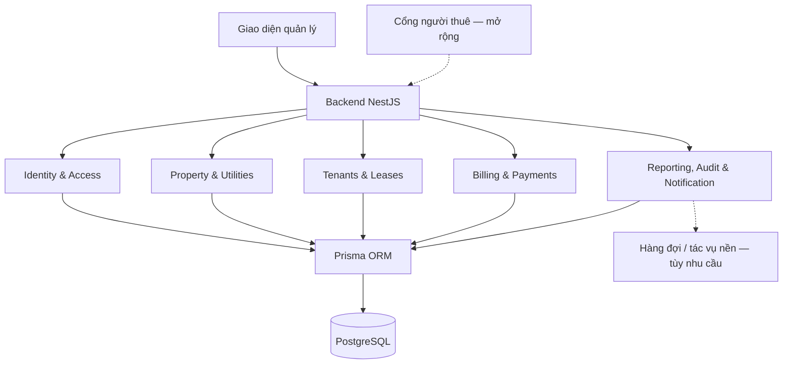

# RentFlow

**Hệ thống quản lý vận hành và minh bạch quy trình thuê trọ.**

RentFlow tập trung dữ liệu khu trọ, phòng, người thuê, hợp đồng, hóa đơn và thanh toán trong một hệ thống thống nhất. Dự án hướng đến việc giảm thao tác thủ công, kiểm soát công nợ và giúp các bên theo dõi thông tin thuê trọ rõ ràng, có lịch sử đối soát.

> **Trạng thái tài liệu:** README mô tả phạm vi và định hướng thiết kế của dự án. Danh sách chức năng bên dưới không đồng nghĩa với việc tất cả chức năng đã được triển khai. Phiên bản công nghệ, cấu trúc thư mục thực tế và lệnh vận hành cần được đối chiếu với source code trước khi sử dụng.

## Mục lục

- [Mục tiêu](#mục-tiêu)
- [Phạm vi sản phẩm](#phạm-vi-sản-phẩm)
- [Vai trò và quyền truy cập](#vai-trò-và-quyền-truy-cập)
- [Quy tắc nghiệp vụ](#quy-tắc-nghiệp-vụ)
- [Kiến trúc hệ thống](#kiến-trúc-hệ-thống)
- [Công nghệ](#công-nghệ)
- [Mô hình dữ liệu](#mô-hình-dữ-liệu)
- [Cấu trúc dự án](#cấu-trúc-dự-án)
- [Thiết lập môi trường](#thiết-lập-môi-trường)
- [Kiểm thử và chất lượng](#kiểm-thử-và-chất-lượng)
- [Phân công trách nhiệm](#phân-công-trách-nhiệm)
- [Quy trình làm việc](#quy-trình-làm-việc)
- [Lộ trình](#lộ-trình)
- [Bảo mật và dữ liệu](#bảo-mật-và-dữ-liệu)
- [Tài liệu thiết kế](#tài-liệu-thiết-kế)
- [Giấy phép và liên hệ](#giấy-phép-và-liên-hệ)

## Mục tiêu

- Chuẩn hóa quy trình từ tiếp nhận người thuê đến lập hợp đồng, bàn giao, thu tiền và thanh lý.
- Quản lý nhiều khu trọ và phòng với quyền truy cập theo phạm vi được phân công.
- Theo dõi hóa đơn, thanh toán một phần, số dư công nợ và tiền cọc riêng biệt.
- Lưu dấu vết thay đổi quan trọng để hỗ trợ kiểm tra và đối soát.
- Cung cấp dữ liệu tổng hợp phục vụ vận hành và ra quyết định.

## Phạm vi sản phẩm

### Chức năng cốt lõi

| Nhóm chức năng | Phạm vi |
| --- | --- |
| Tài khoản và phân quyền | Đăng nhập, quản lý tài khoản nhân viên, phân quyền theo vai trò và khu trọ. |
| Khu trọ và phòng | Quản lý khu trọ, phòng, giá thuê cơ bản, sức chứa và trạng thái phòng. |
| Dịch vụ và điện nước | Thiết lập đơn giá, ghi nhận chỉ số điện nước theo kỳ, cung cấp dữ liệu lập hóa đơn. |
| Người thuê | Lưu hồ sơ, thông tin liên hệ và danh sách người ở trong từng hợp đồng. |
| Hợp đồng thuê | Lập và theo dõi hợp đồng, thời hạn, giá thuê thỏa thuận, kỳ thanh toán và tiền cọc. |
| Bàn giao và thanh lý | Ghi nhận tài sản, chỉ số nhận/trả phòng, khấu trừ và hoàn trả tiền cọc. |
| Hóa đơn và thanh toán | Lập hóa đơn, ghi nhận thanh toán toàn bộ hoặc một phần, phân bổ tiền và đối chiếu công nợ. |
| Báo cáo và thông báo | Tổng hợp doanh thu, công nợ, trạng thái phòng và hợp đồng sắp hết hạn; hỗ trợ nhắc hạn. |
| Nhật ký kiểm toán | Ghi nhận các thao tác quan trọng liên quan đến giá, hợp đồng và giao dịch tài chính. |

### Chức năng mở rộng

Các chức năng sau nằm ngoài mô hình dữ liệu cốt lõi 17 lớp hiện tại và cần được phân tích riêng trước khi triển khai:

- Quản lý chi phí vận hành, nhà cung cấp và báo cáo lợi nhuận.
- Quản lý thiết bị, yêu cầu sửa chữa và quy trình bảo trì.
- Cổng thông tin người thuê và ứng dụng di động.
- Xuất hợp đồng, báo cáo PDF hoặc bảng tính.
- Tích hợp cổng thanh toán và thông báo Email, SMS hoặc Zalo.
- Lưu trữ hồ sơ, hình ảnh và tệp đính kèm trên dịch vụ lưu trữ đối tượng.

## Vai trò và quyền truy cập

| Vai trò | Phạm vi trách nhiệm dự kiến |
| --- | --- |
| `OWNER` — Chủ trọ | Quản lý khu trọ thuộc quyền sở hữu, nhân viên, cấu hình và hoạt động kinh doanh. |
| `STAFF` — Nhân viên quản lý | Thực hiện nghiệp vụ vận hành trong những khu trọ được phân công. |
| `ACCOUNTANT` — Kế toán | Thực hiện nghiệp vụ hóa đơn, thanh toán và đối soát theo quyền được cấp. |
| `TENANT` — Người thuê | Xem dữ liệu thuê trọ của chính mình khi cổng thông tin người thuê được triển khai. |

Quyền truy cập phải được kiểm tra tại backend theo cả **vai trò** và **phạm vi dữ liệu**. Một người dùng không mặc nhiên có quyền xem mọi khu trọ chỉ vì đã đăng nhập.

`Tenant` là hồ sơ người thuê; `User` là tài khoản đăng nhập. Hai thực thể không mặc nhiên tương đương. Liên kết giữa hồ sơ và tài khoản cần được thiết kế trước khi triển khai cổng thông tin người thuê.

## Quy tắc nghiệp vụ

Các nguyên tắc dưới đây được tổng hợp từ tài liệu phân công. Nội dung chi tiết và mã BR phải được đối chiếu với PRD chính thức khi nhóm chốt thiết kế.

| Quy tắc | Yêu cầu |
| --- | --- |
| Không trùng hợp đồng hiệu lực — BR-01 | Không để một phòng có các hợp đồng hiệu lực xung đột. Bản thiết kế hiện tại dùng giới hạn tối đa một hợp đồng `ACTIVE` trên mỗi phòng. |
| Lưu đơn giá tại thời điểm lập hóa đơn — BR-02 | Mỗi dòng hóa đơn lưu `snapshotUnitPrice`; thay đổi bảng giá không tự thay đổi hóa đơn đã lập. |
| Thanh toán một phần và phân bổ — BR-03 | Theo dõi số tiền đã trả, còn lại và khoản phân bổ vào từng hóa đơn. |
| Bảo toàn lịch sử giao dịch — BR-04 | Không xóa hoặc sửa âm thầm giao dịch đã ghi nhận; điều chỉnh phải có trạng thái và dấu vết đối soát. |
| Quản lý tiền cọc riêng — BR-05 | Phân biệt tiền cọc với tiền thuê, tiền thanh toán hóa đơn và doanh thu. |
| Phân quyền theo khu trọ — BR-06 | Chỉ người có quyền mới được truy cập hoặc cập nhật dữ liệu của khu trọ tương ứng. |
| Đối soát thanh toán — BR-07 | Xác định phương thức, mã tham chiếu và cách xử lý giao dịch trùng/sai theo PRD. |
| Nhật ký kiểm toán — BR-08 | Ghi nhận người thực hiện, hành động, thời điểm và dữ liệu thay đổi cần thiết đối với nghiệp vụ quan trọng. |

**Quy ước dữ liệu:**

- Tên lớp/model dùng `PascalCase`; thuộc tính dùng `camelCase`.
- Dùng tên `Lease` / `Leases` thống nhất cho hợp đồng thuê trong code và tài liệu.
- Các trường tiền tệ dùng `Decimal` / `NUMERIC`; không dùng `Float` hoặc phép tính số thực JavaScript thông thường để tính tiền.
- Ngày hợp đồng được xử lý như ngày nghiệp vụ; thời điểm phát sinh sự kiện phải có quy ước múi giờ rõ ràng.
- Khi quyết toán toàn bộ tiền cọc: **tiền khấu trừ + tiền hoàn trả = tiền cọc đã ghi nhận**. Trường hợp giữ lại cọc hoặc quyết toán từng phần cần quy trình riêng.
- Việc hỗ trợ đặt trước hoặc gia hạn hợp đồng cần được thiết kế phù hợp với cách xác định hợp đồng hiệu lực.

## Kiến trúc hệ thống

RentFlow định hướng sử dụng **Modular Monolith**: backend được tổ chức thành các module có trách nhiệm rõ ràng và triển khai như một ứng dụng thống nhất. Việc tách module phục vụ bảo trì và mở rộng, không đồng nghĩa với kiến trúc microservices.



- Frontend gọi backend qua API; backend chịu trách nhiệm xác thực, phân quyền và kiểm tra nghiệp vụ.
- PostgreSQL là nguồn dữ liệu nghiệp vụ chính; Prisma hỗ trợ truy cập dữ liệu và quản lý migration.
- Các thao tác liên quan đến hợp đồng, trạng thái phòng và tài chính cần được tổ chức trong transaction phù hợp.
- Ràng buộc quan trọng phải được bảo vệ ở database khi có thể, bên cạnh validation ở tầng ứng dụng.
- Redis, tác vụ nền, lưu trữ tệp và nhà cung cấp thông báo là các thành phần bổ sung khi có nhu cầu cụ thể.

## Công nghệ

| Thành phần | Định hướng |
| --- | --- |
| Backend | Node.js, NestJS, TypeScript |
| Database | PostgreSQL |
| Truy cập dữ liệu | Prisma ORM |
| Frontend quản lý | Next.js, React, TypeScript, Tailwind CSS |
| Quản lý mã nguồn | Git và GitHub |
| Quản lý công việc | Jira |
| Thiết kế và thuyết minh | Draw.io và Google Docs |
| Công cụ bổ sung | Docker, GitHub Actions, Redis, Nginx hoặc lưu trữ S3-compatible khi được triển khai |

Phiên bản chính xác phải lấy từ `package.json`, lockfile và cấu hình runtime của repository. Không coi danh sách công nghệ là bằng chứng rằng dịch vụ tương ứng đã được cấu hình hoặc đang hoạt động.

## Mô hình dữ liệu

Mô hình thiết kế cốt lõi gồm **17 lớp**:

| Phân hệ | Các lớp |
| --- | --- |
| Identity & Audit | `User`, `Role`, `UserPropertyAccess`, `AuditLog` |
| Property & Utilities | `Property`, `Room`, `UtilityRate`, `MeterReading` |
| Tenant & Lease | `Tenant`, `Lease`, `LeaseTenant`, `Handover`, `Notification` |
| Billing & Payment | `Invoice`, `InvoiceItem`, `Payment`, `PaymentAllocation` |

Các liên kết chính:

- `Property` quản lý các `Room` và `UtilityRate`.
- `Room` liên kết với lịch sử `Lease` và các kỳ `MeterReading`.
- `LeaseTenant` liên kết hợp đồng với các người thuê và xác định người đại diện.
- `Handover` lưu thông tin nhận/trả phòng gắn với hợp đồng.
- `Invoice` gồm các `InvoiceItem`; `PaymentAllocation` liên kết khoản thanh toán với hóa đơn.
- `UserPropertyAccess` xác định quyền theo khu trọ; `Notification` xác định tài khoản nhận thông báo.

Schema, sơ đồ lớp và đặc tả nghiệp vụ phải được cập nhật đồng bộ. Những ràng buộc SQL tùy chỉnh phải được lưu trong migration và kiểm thử cùng schema.

## Cấu trúc dự án

Đây là cấu trúc mục tiêu rút gọn. Chỉ tạo thêm ứng dụng hoặc service khi có nhu cầu triển khai đã được thống nhất.

```text
rentflow/
├── apps/
│   └── admin/                    # Giao diện quản lý
├── services/
│   └── api/
│       ├── src/                  # Các module backend
│       ├── prisma/
│       │   ├── schema.prisma
│       │   └── migrations/
│       └── test/                 # Kiểm thử tích hợp / API
├── packages/                     # Mã dùng chung khi cần
├── docs/
│   ├── requirements/             # PRD, quy tắc nghiệp vụ, Use Case
│   ├── architecture/             # Kiến trúc, UML, quyết định thiết kế
│   └── deployment/               # Hướng dẫn triển khai khi đã xác minh
├── infra/                        # Cấu hình hạ tầng khi được triển khai
├── scripts/                      # Script hỗ trợ phát triển
└── README.md
```

Cổng người thuê, mobile app, worker và notifier độc lập chưa được coi là thành phần bắt buộc của giai đoạn đầu. Module thông báo có thể nằm trong backend trước khi cần tách tiến trình xử lý.

## Thiết lập môi trường

### Điều kiện chuẩn bị

- Quyền truy cập repository thật của nhóm.
- Git và Node.js tương thích với cấu hình dự án.
- Package manager và phiên bản phù hợp với `packageManager` / lockfile trong repository.
- PostgreSQL tương thích với cấu hình database của nhóm.
- Redis hoặc Docker chỉ khi source và môi trường chạy yêu cầu.

### Quy trình thiết lập

1. Clone repository từ URL thật của nhóm và mở thư mục gốc dự án.
2. Đọc `package.json`, lockfile và README của từng ứng dụng/service để xác định package manager và scripts.
3. Cài dependencies bằng package manager đã thống nhất; không trộn nhiều loại lockfile.
4. Nếu có `.env.example`, sao chép thành file môi trường theo hướng dẫn của service và điền cấu hình local.
5. Khởi tạo PostgreSQL; chạy generate, migration và seed bằng scripts đã có trong repository. Chỉ chạy seed nếu dự án cung cấp cấu hình seed.
6. Khởi động backend và frontend theo scripts thực tế; kiểm tra cổng và địa chỉ truy cập từ cấu hình hoặc log khởi động.

**Các biến môi trường thường cần:**

| Biến | Mục đích | Điều kiện sử dụng |
| --- | --- | --- |
| `DATABASE_URL` | Chuỗi kết nối PostgreSQL | Backend có truy cập database |
| `JWT_SECRET` | Khóa ký token | Khi module Auth dùng biến cấu hình này |
| `PORT` | Cổng backend | Theo cấu hình bootstrap |
| `REDIS_URL` | Kết nối Redis | Khi cache hoặc hàng đợi đã được tích hợp |

Tên biến cuối cùng phải khớp với source code. Không lưu thông tin đăng nhập thật hoặc khóa bí mật trong README.

> Lệnh cài đặt, migrate, seed, chạy ứng dụng và Docker sẽ được bổ sung sau khi xác minh repository. Đường dẫn `services/api/prisma/schema.prisma` trong thiết kế không tự bảo đảm rằng lệnh Prisma chạy được từ thư mục gốc.

## Kiểm thử và chất lượng

Nhóm cần xác định các scripts lint, kiểm tra kiểu dữ liệu, kiểm thử và build trong từng package. Pull request phải ghi rõ lệnh đã chạy, kết quả và phần chưa được kiểm tra.

Các tình huống nghiệp vụ ưu tiên:

| Nhóm | Tình huống cần kiểm thử |
| --- | --- |
| Phân quyền | Truy cập dữ liệu ngoài khu trọ được phân công bị từ chối. |
| Hợp đồng | Tạo đồng thời các hợp đồng xung đột cho cùng phòng không làm sai dữ liệu. |
| Người ở | Danh sách hợp lệ, không trùng người thuê, đúng một đại diện, không vượt sức chứa. |
| Bàn giao | Chỉ số và trạng thái hợp lệ; không ghi trùng biên bản cùng loại. |
| Tiền cọc | Khấu trừ/hoàn cọc đúng quy tắc; dữ liệu tiền không âm; không tự tính cọc thành doanh thu thuê. |
| Hóa đơn | Thay đổi đơn giá dịch vụ không làm đổi đơn giá đã chốt trên hóa đơn. |
| Thanh toán | Thanh toán một phần, phân bổ và điều chỉnh giữ được công nợ chính xác. |
| Thông báo | Chỉ người nhận có quyền truy cập; xử lý tác vụ lại không gây thông báo trùng ngoài chủ đích. |
| Audit | Thao tác quan trọng tạo nhật ký phù hợp, đồng bộ với thay đổi dữ liệu. |

Các kiểm thử chạy trên gói code độc lập không thay thế kiểm thử tích hợp của repository chung.

## Phân công trách nhiệm

| Thành viên | Phạm vi chính | Trách nhiệm tổng hợp |
| --- | --- | --- |
| Nguyễn Minh Hiếu | Tài khoản, phân quyền, AuditLog và nền tảng backend | Kiến trúc hệ thống; điều phối tích hợp schema |
| Phan Nguyên Vũ | Khu trọ, phòng, đơn giá dịch vụ và chỉ số điện nước | Use Case tổng thể; chuẩn hóa bố cục báo cáo |
| Hoàng Đình Phùng | Người thuê, hợp đồng, bàn giao và Notification | Class Diagram tổng thể đủ 17 lớp |
| Huỳnh Việt Tiến | Hóa đơn, thanh toán, công nợ và báo cáo tài chính | Rà soát nghiệp vụ tài chính trong thiết kế chung |

Mỗi thành viên chịu trách nhiệm thiết kế và kiểm tra module của mình. Người tổng hợp ghép nối, chuẩn hóa và rà soát tính nhất quán; không thay thế trách nhiệm của người phụ trách module.

## Quy trình làm việc

### Jira

- Mỗi task có phạm vi rõ ràng, assignee, tiêu chí nghiệm thu và sản phẩm bàn giao.
- Chia task theo đầu ra có thể kiểm tra; tránh ghi nhiều lần cùng một phần việc.
- Cập nhật trạng thái theo tiến độ thực tế và workflow của dự án.
- Ghi worklog theo thời gian thực tế; original estimate chỉ dùng để lập kế hoạch.
- Đính kèm đường dẫn tài liệu, commit hoặc pull request làm bằng chứng.

### Git và pull request

- Tạo nhánh riêng từ nhánh cơ sở đã được nhóm thống nhất.
- Dùng issue key Jira thật trong tên nhánh và commit khi có liên kết công việc.
- Kiểm tra diff trước khi commit; không đưa `.env`, dữ liệu nhạy cảm hoặc `node_modules` vào repository.
- Gửi pull request có mô tả thay đổi, cách kiểm tra và ảnh hưởng đến module khác.
- Thay đổi schema/migration cần được review trước khi áp dụng vào database dùng chung.
- Không sửa lịch sử commit hoặc danh tính tác giả để tạo minh chứng chấm công.

Quy ước tên nhánh đề xuất: `feat/<issue-key>-<short-description>`, `fix/<issue-key>-<short-description>` và `docs/<issue-key>-<short-description>`. Thay placeholder bằng dữ liệu thật trước khi sử dụng.

### Tiêu chí hoàn thành

Một task chỉ được đánh dấu hoàn thành khi:

- Sản phẩm đúng phạm vi và đáp ứng tiêu chí nghiệm thu.
- Code/tài liệu đã được bàn giao vào vị trí chung của nhóm.
- Các kiểm tra phù hợp đã đạt; giới hạn kiểm thử được ghi rõ.
- Người review hoặc người tổng hợp đã ghi nhận kết quả.
- Không còn lỗi nghiêm trọng đã biết trong phạm vi task.

## Lộ trình

| Giai đoạn | Trọng tâm | Đầu ra kỳ vọng |
| --- | --- | --- |
| 1. Thiết kế | Kiến trúc, Use Case, Class Diagram, quy tắc nghiệp vụ và schema | Bộ thiết kế thống nhất, có review của 4 thành viên |
| 2. MVP | Phân quyền, khu trọ/phòng, người thuê/hợp đồng, bàn giao, hóa đơn/thanh toán | Luồng vận hành cốt lõi được kiểm thử tích hợp |
| 3. Hoàn thiện vận hành | Dashboard, nhắc hạn, audit, chất lượng dữ liệu và trải nghiệm sử dụng | Bản chạy thử có thể đánh giá và đối soát |
| 4. Mở rộng | Chi phí, bảo trì, cổng người thuê, xuất báo cáo và tích hợp bên ngoài | Chức năng bổ sung theo ưu tiên được nhóm phê duyệt |

Mốc công việc cụ thể được theo dõi trên Jira. Tài liệu phân công đặt mốc bản nháp nội bộ ngày **01/11/2026** và mốc nộp báo cáo dự kiến ngày **16/11/2026**; ngày nộp chính thức cần đối chiếu thông báo của giảng viên.

## Bảo mật và dữ liệu

- Lưu mật khẩu bằng cơ chế băm phù hợp; không lưu mật khẩu dạng rõ.
- Kiểm tra xác thực, phân quyền và dữ liệu đầu vào tại backend.
- Hạn chế quyền truy cập hồ sơ định danh, thông tin liên hệ và dữ liệu tài chính.
- Không ghi toàn bộ giấy tờ định danh, token, mật khẩu hoặc secret vào log.
- AuditLog chỉ lưu thông tin cần thiết cho mục đích kiểm toán; áp dụng quyền đọc phù hợp.
- Dùng dữ liệu giả cho demo và kiểm thử; không commit dữ liệu người thuê thật.
- Quản lý migration, sao lưu và thử phục hồi trước các thay đổi ảnh hưởng đến dữ liệu dùng chung.

Các nội dung trên là yêu cầu triển khai và kiểm tra, không phải tuyên bố hệ thống đã hoàn thành đánh giá bảo mật.

## Tài liệu thiết kế

Bộ tài liệu của nhóm gồm:

| Tài liệu | Nội dung |
| --- | --- |
| `Nhom3_RentFlow_UML.drawio` | Ba trang: `KienTruc`, `Usecase`, `ClassDiagram` |
| `Nhom3_ThuyetMinhThietKe_RentFlow` | Kiến trúc, Use Case và đặc tả, sơ đồ lớp và thiết kế dữ liệu |
| `services/api/prisma/schema.prisma` | Mô hình dữ liệu được đồng bộ với thiết kế |
| Migration và kiểm thử | Thay đổi database, các ràng buộc và bằng chứng kiểm tra |

Bổ sung liên kết thật tới Drive, Jira và repository sau khi nhóm xác nhận. Không sử dụng URL minh họa như liên kết chính thức.

## Giấy phép và liên hệ

**Giấy phép:** cần được nhóm xác nhận và thể hiện bằng tệp `LICENSE` trong repository. README này không mặc định tuyên bố dự án được cấp phép MIT.

**Liên hệ dự án:** [hoangphung.tech@gmail.com](mailto:hoangphung.tech@gmail.com).

Báo lỗi, đề xuất và trao đổi triển khai được theo dõi qua Jira hoặc hệ thống issue của repository chính thức do nhóm cung cấp.
