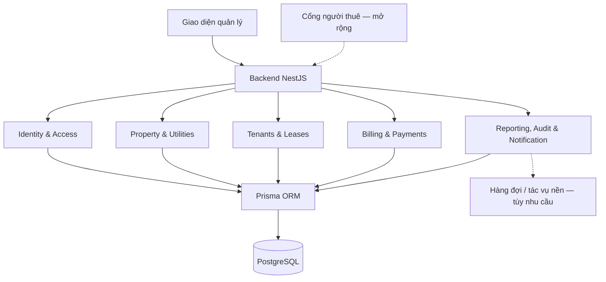

# RentFlow

> **Tài liệu dự án — bản thiết kế & hướng dẫn triển khai 1.3 (12/11/2026)**
> **Phạm vi:** Chuẩn hóa README và đề xuất hướng kiểm chứng thực tế. Không xác nhận tính năng mới đã được lập trình, người dùng đã được khảo sát hay hệ thống đã triển khai thành công.

**Hệ thống quản lý vận hành và minh bạch quy trình thuê trọ.**

RentFlow tập trung dữ liệu khu trọ, phòng, người thuê, hợp đồng, hóa đơn và thanh toán trong một hệ thống thống nhất. Dự án hướng đến việc giảm thao tác thủ công, kiểm soát công nợ và giúp các bên theo dõi thông tin thuê trọ rõ ràng, có lịch sử đối soát. **Định hướng khác biệt:** biến mỗi hợp đồng, lần bàn giao và khoản quyết toán tiền cọc thành một chuỗi thông tin có thể kiểm chứng, giải thích và đối chiếu giữa các bên.

> **Trạng thái tài liệu:** README mô tả phạm vi và định hướng thiết kế của dự án. Danh sách chức năng bên dưới không đồng nghĩa với việc tất cả chức năng đã được triển khai. Phiên bản công nghệ, cấu trúc thư mục thực tế và lệnh vận hành cần được đối chiếu với source code trước khi sử dụng.

**Tình trạng xác minh (12/11/2026):** Mô hình sản phẩm, 17 lớp và lộ trình là **thiết kế đề xuất**; **chưa đối chiếu mã nguồn đang chạy**, chưa xác nhận khảo sát, test E2E hay bản deploy. README này có thể dùng để phối hợp phát triển và chuẩn bị triển khai, **không chứng minh môi trường production đã sẵn sàng**.

| Hạng mục | Trạng thái | Bằng chứng cần có để xác nhận |
| --- | --- | --- |
| Phạm vi, nghiệp vụ, kiến trúc | Đã đặc tả ở mức README; chờ nhóm duyệt | PRD/UML/ADR được review |
| Repository và hướng dẫn chạy | **Chưa xác minh** | URL + commit, scripts, bản chạy local, log/ảnh |
| Test tích hợp / bảo mật | **NOT RUN / chưa cung cấp** | Báo cáo PASS/FAIL theo commit |
| Khảo sát / KPI thực tế | **Chưa thực hiện / chưa cung cấp** | Biên bản ẩn danh và kết quả đo |
| Triển khai staging / production | **Chưa xác minh** | Runbook đã chạy, smoke test, kế hoạch rollback |

**Đọc nhanh:** [Giá trị khác biệt](#giá-trị-khác-biệt-và-điểm-sáng-tạo) · [Phạm vi MVP](#ranh-giới-mvp-và-phần-mở-rộng) · [Thiết lập môi trường](#thiết-lập-môi-trường) · [Runbook triển khai](#runbook-triển-khai-và-vận-hành) · [Tiêu chí nghiệm thu](#kịch-bản-demo-và-tiêu-chí-nghiệm-thu) · [Quyết định cần chốt](#sổ-quyết-định-thiết-kế-cần-nhóm-phê-duyệt).

## Mục lục

<!-- Liên kết được đồng bộ với các tiêu đề cấp 2 trong README. -->
- [Mục tiêu](#mục-tiêu)
- [Người dùng mục tiêu và vấn đề cần kiểm chứng](#người-dùng-mục-tiêu-và-vấn-đề-cần-kiểm-chứng)
- [Giá trị khác biệt và điểm sáng tạo](#giá-trị-khác-biệt-và-điểm-sáng-tạo)
- [Phạm vi sản phẩm](#phạm-vi-sản-phẩm)
- [Vai trò và quyền truy cập](#vai-trò-và-quyền-truy-cập)
- [Quy tắc nghiệp vụ](#quy-tắc-nghiệp-vụ)
- [Kiến trúc hệ thống](#kiến-trúc-hệ-thống)
- [Công nghệ](#công-nghệ)
- [Mô hình dữ liệu](#mô-hình-dữ-liệu)
- [Cấu trúc dự án](#cấu-trúc-dự-án)
- [Thiết lập môi trường](#thiết-lập-môi-trường)
- [Runbook triển khai và vận hành](#runbook-triển-khai-và-vận-hành)
- [Kiểm thử và chất lượng](#kiểm-thử-và-chất-lượng)
- [Khảo sát và xác minh nhu cầu thực tế](#khảo-sát-và-xác-minh-nhu-cầu-thực-tế)
- [Chỉ số đo lường hiệu quả](#chỉ-số-đo-lường-hiệu-quả)
- [Kịch bản demo và tiêu chí nghiệm thu](#kịch-bản-demo-và-tiêu-chí-nghiệm-thu)
- [Phân công trách nhiệm](#phân-công-trách-nhiệm)
- [Quy trình làm việc](#quy-trình-làm-việc)
- [Lộ trình](#lộ-trình)
- [Rủi ro và quyết định cần chốt](#rủi-ro-và-quyết-định-cần-chốt)
- [Bảo mật và dữ liệu](#bảo-mật-và-dữ-liệu)
- [Tài liệu thiết kế](#tài-liệu-thiết-kế)
- [Lịch sử cập nhật README](#lịch-sử-cập-nhật-readme)
- [Giấy phép và liên hệ](#giấy-phép-và-liên-hệ)

## Mục tiêu

- Chuẩn hóa quy trình từ tiếp nhận người thuê đến lập hợp đồng, bàn giao, thu tiền và thanh lý.
- Quản lý nhiều khu trọ và phòng với quyền truy cập theo phạm vi được phân công.
- Theo dõi hóa đơn, thanh toán một phần, số dư công nợ và tiền cọc riêng biệt.
- Lưu dấu vết thay đổi quan trọng để hỗ trợ kiểm tra và đối soát.
- Cung cấp dữ liệu tổng hợp phục vụ vận hành và ra quyết định.

## Người dùng mục tiêu và vấn đề cần kiểm chứng

| Nhóm người dùng                | Công việc cần làm                                   | Khó khăn giả định cần khảo sát                                                                 |
| ------------------------------ | --------------------------------------------------- | ---------------------------------------------------------------------------------------------- |
| Chủ trọ có nhiều phòng/khu trọ | Theo dõi phòng, hợp đồng, thu tiền, cọc và công nợ  | Sổ sách phân tán, đối soát thủ công, khó kiểm tra lịch sử                                      |
| Nhân viên quản lý              | Bàn giao, ghi điện nước, nhắc hạn và cập nhật phòng | Trùng thao tác, quên lịch, thiếu bằng chứng nhận/trả phòng                                     |
| Kế toán/thu ngân               | Lập hóa đơn, nhận tiền, phân bổ và đối soát         | Thanh toán từng phần, khoản thu khó truy vết                                                   |
| Người thuê                     | Kiểm tra thỏa thuận, tiền đã đóng và quyết toán cọc | Thiếu minh bạch về số liệu/biên bản; chỉ áp dụng khi có giao diện hoặc cơ chế xác nhận phù hợp |

> Đây là **giả thuyết sản phẩm**, chưa phải kết quả khảo sát hay kết luận về thị trường. Nhóm cần xác minh bằng phỏng vấn và thử nghiệm trước khi khẳng định hiệu quả.

## Giá trị khác biệt và điểm sáng tạo

**Tuyên bố giá trị đề xuất:** RentFlow không chỉ là phần mềm nhập phòng và lập hóa đơn; trọng tâm là **quy trình thuê trọ minh bạch có dấu vết kiểm chứng** từ ký hợp đồng, nhận phòng, ghi nhận các khoản tiền, đến thanh lý và hoàn cọc.

| Sáng kiến                   | Trải nghiệm đề xuất                                                                                                 | Trạng thái/phạm vi                                                                                                                         |
| --------------------------- | ------------------------------------------------------------------------------------------------------------------- | ------------------------------------------------------------------------------------------------------------------------------------------ |
| Bàn giao có bằng chứng số   | So sánh biên bản nhận/trả phòng, danh mục tài sản và chỉ số đầu/cuối; có thể đính kèm ảnh hoặc xác nhận của các bên | **Đề xuất mở rộng**. Hiện `Handover` nằm trong mô hình 17 lớp; lưu ảnh, chữ ký, tệp cần đặc tả thêm và có thể phát sinh model/file storage |
| Quyết toán cọc minh bạch    | Hiện cọc thỏa thuận, cọc thực thu, từng khoản khấu trừ với lý do, số còn giữ và số hoàn trả                         | **Ưu tiên thiết kế/MVP**, bám BR-05; cách lưu khoản khấu trừ phải được chốt với schema và giao dịch                                        |
| Dòng thời gian có kiểm toán | Truy vết ai cập nhật hợp đồng, chỉ số, hóa đơn, khoản thu và lúc nào                                                | **Có định hướng cốt lõi** theo `AuditLog`; giao diện timeline là đề xuất sản phẩm                                                          |
| Cảnh báo theo ngữ cảnh      | Nhắc hợp đồng sắp hết hạn, chưa ghi chỉ số, công nợ quá hạn hoặc giao dịch cần đối soát                             | **Triển khai theo giai đoạn**, không tự suy ra đã có worker/Email/SMS                                                                      |

**Nguyên tắc đổi mới:** Ưu tiên rõ ràng, bằng chứng và kiểm chứng nghiệp vụ hơn là thêm AI hay tính năng phức tạp khi chưa có nhu cầu thực tế. Mỗi sáng kiến phải có giả thuyết, tiêu chí nghiệm thu, dữ liệu thử nghiệm và người phụ trách.

### Trải nghiệm khác biệt cần chứng minh (đề xuất)

**Tình huống:** Khi kết thúc hợp đồng, người quản lý và người thuê thường cần trả lời cùng bốn câu hỏi: *ban đầu nhận gì, đã đóng bao nhiêu, tại sao bị trừ, cuối cùng được nhận lại bao nhiêu?* RentFlow hướng tới một luồng kiểm chứng liên tục:

1. **Khi nhận phòng:** Lưu tình trạng tài sản, chỉ số điện/nước đầu kỳ và người lập biên bản trong `Handover`.
2. **Trong thời gian thuê:** Lưu đơn giá theo kỳ trong `InvoiceItem`, giao dịch trong `Payment`, phân bổ vào hóa đơn trong `PaymentAllocation` và dấu vết cần thiết trong `AuditLog`.
3. **Khi trả phòng:** Đối chiếu chỉ số và biên bản nhận/trả, tạo bảng quyết toán cọc có từng lý do khấu trừ; không ngầm coi tiền cọc là doanh thu.
4. **Khi xác nhận:** Quản lý đối chiếu nội dung với người thuê và ghi nhận phương thức xác nhận theo **DEC-04**. Trong MVP chưa có cổng người thuê, ảnh minh chứng hay chữ ký điện tử, vì vậy **chưa thể tuyên bố hai bên tự tra cứu/ký xác nhận trực tuyến**.

**Ví dụ minh họa để thiết kế và test (không phải dữ liệu khách hàng thật):** Cọc thỏa thuận **3.000.000đ**, thực thu **2.500.000đ**, khấu trừ hợp lệ **350.000đ**, hoàn trả **2.150.000đ**, số cọc còn giữ sau tất toán **0đ**. Chênh lệch **500.000đ** giữa cọc thỏa thuận và cọc thực thu phải được trình bày riêng, **không tự tính là tiền đã nhận**. Giả sử đã quyết toán toàn bộ khoản thực thu, kiểm tra `2.500.000 = 350.000 + 2.150.000` (đơn vị: đồng). Phải phân biệt rõ quy tắc này với trường hợp hoàn cọc từng phần hoặc còn giữ cọc, vốn đang chờ nhóm duyệt.

**Giá trị cần kiểm chứng bằng người dùng thật:** người dùng có thể giải thích mỗi khoản khấu trừ bằng dữ liệu gốc; tìm được lịch sử thay đổi; đối soát nhanh hơn cách đang dùng. Đây là **giả thuyết**, không phải kết quả khảo sát hoặc tuyên bố RentFlow hơn các sản phẩm khác.

## Phạm vi sản phẩm

### Chức năng cốt lõi

| Nhóm chức năng          | Phạm vi                                                                                    |
| ----------------------- | ------------------------------------------------------------------------------------------ |
| Tài khoản và phân quyền | Đăng nhập, quản lý tài khoản nhân viên, phân quyền theo vai trò và khu trọ.                |
| Khu trọ và phòng        | Quản lý khu trọ, phòng, giá thuê cơ bản, sức chứa và trạng thái phòng.                     |
| Dịch vụ và điện nước    | Thiết lập đơn giá, ghi nhận chỉ số điện nước theo kỳ, cung cấp dữ liệu lập hóa đơn.        |
| Người thuê              | Lưu hồ sơ, thông tin liên hệ và danh sách người ở trong từng hợp đồng.                     |
| Hợp đồng thuê           | Lập và theo dõi hợp đồng, thời hạn, giá thuê thỏa thuận, kỳ thanh toán và tiền cọc.        |
| Bàn giao và thanh lý    | Ghi nhận tài sản, chỉ số nhận/trả phòng, khấu trừ và hoàn trả tiền cọc.                    |
| Hóa đơn và thanh toán   | Lập hóa đơn, ghi nhận thanh toán toàn bộ hoặc một phần, phân bổ tiền và đối chiếu công nợ. |
| Báo cáo và thông báo    | Tổng hợp doanh thu, công nợ, trạng thái phòng và hợp đồng sắp hết hạn; hỗ trợ nhắc hạn.    |
| Nhật ký kiểm toán       | Ghi nhận các thao tác quan trọng liên quan đến giá, hợp đồng và giao dịch tài chính.       |

### Ranh giới MVP và phần mở rộng

**Phạm vi MVP dự kiến:** đăng nhập/phân quyền; khu trọ/phòng; người thuê/hợp đồng; bàn giao cơ bản; kỳ điện nước; hóa đơn, thanh toán từng phần, công nợ và cọc; audit thao tác quan trọng. Các ưu tiên dưới đây là **đề xuất lập kế hoạch**, chưa thay đổi phạm vi đã được nhóm duyệt.

| Ưu tiên                              | Hạng mục                                                                                                      | Điều kiện hoàn tất dự kiến                                                           |
| ------------------------------------ | ------------------------------------------------------------------------------------------------------------- | ------------------------------------------------------------------------------------ |
| **P0 — Nền tảng chạy được**          | Đăng nhập, phân quyền theo khu trọ; khu trọ/phòng; hồ sơ người thuê; hợp đồng; bàn giao cơ bản                | E2E-01 và kịch bản truy cập sai quyền được kiểm tra; dữ liệu và trạng thái nhất quán |
| **P1 — Nghiệp vụ tài chính cốt lõi** | Kỳ điện nước; lập hóa đơn; thanh toán từng phần; công nợ; quản lý/hoàn tiền cọc; audit các thay đổi trọng yếu | E2E-02 và E2E-03 được kiểm tra với dữ liệu chuẩn và dấu vết đối soát                 |
| **P2 — Hoàn thiện trải nghiệm**      | Dashboard, nhắc hạn nâng cao, timeline kiểm toán, bảng đối soát dễ hiểu                                       | Chỉ làm sau khi P0/P1 ổn định và được nhóm phê duyệt                                 |
| **P3 — Mở rộng**                     | Ảnh/chữ ký minh chứng, cổng người thuê, app di động, thanh toán thực, thông báo bên ngoài                     | Cần PRD, mô hình dữ liệu, quyền truy cập và kiểm thử riêng                           |

**Giới hạn MVP cần ghi rõ với người dùng:**

- **Thanh toán:** chỉ **ghi nhận khoản tiền đã thu thủ công hoặc giả lập** và phân bổ vào công nợ; **không xử lý chuyển khoản thật**, không xác nhận tự động trạng thái ngân hàng. Biên nhận nhập tay phải có người nhập, thời điểm và quy tắc ngăn nhập trùng theo **DEC-03**.
- **Bàn giao:** lưu biên bản dữ liệu cơ bản và chỉ số nhận/trả. Ảnh, chữ ký số, lưu tệp và bằng chứng đối soát hai chiều là **P3**, không được mô tả là có sẵn.
- **Minh bạch với người thuê:** ở MVP, **quản lý là người hiển thị/đối chiếu thông tin khi làm việc trực tiếp**; chưa có màn hình đăng nhập cho `TENANT`. Khả năng in/xuất báo cáo, cấp bản đối soát hoặc xác nhận hai bên phải được phê duyệt ở **DEC-07**, không tự coi là chức năng đã phát triển.

**Không cam kết trong MVP hiện tại:** chữ ký điện tử, tải ảnh minh chứng, cổng người thuê, ứng dụng di động, kết nối ngân hàng, thanh toán thật, gửi thông báo qua kênh bên ngoài. Mốc hoàn thành và người phụ trách cần được lập thành issue/task thật trước khi triển khai.

### Chức năng mở rộng

Các chức năng sau nằm ngoài mô hình dữ liệu cốt lõi 17 lớp hiện tại và cần được phân tích riêng trước khi triển khai:

- Quản lý chi phí vận hành, nhà cung cấp và báo cáo lợi nhuận.
- Quản lý thiết bị, yêu cầu sửa chữa và quy trình bảo trì.
- Cổng thông tin người thuê và ứng dụng di động.
- Xuất hợp đồng, báo cáo PDF hoặc bảng tính.
- Tích hợp cổng thanh toán và thông báo Email, SMS hoặc Zalo.
- Lưu trữ hồ sơ, hình ảnh và tệp đính kèm trên dịch vụ lưu trữ đối tượng.

## Vai trò và quyền truy cập

| Vai trò                     | Phạm vi trách nhiệm dự kiến                                                        |
| --------------------------- | ---------------------------------------------------------------------------------- |
| `OWNER` — Chủ trọ           | Quản lý khu trọ thuộc quyền sở hữu, nhân viên, cấu hình và hoạt động kinh doanh.   |
| `STAFF` — Nhân viên quản lý | Thực hiện nghiệp vụ vận hành trong những khu trọ được phân công.                   |
| `ACCOUNTANT` — Kế toán      | Thực hiện nghiệp vụ hóa đơn, thanh toán và đối soát theo quyền được cấp.           |
| `TENANT` — Người thuê       | Xem dữ liệu thuê trọ của chính mình khi cổng thông tin người thuê được triển khai. |

Quyền truy cập phải được kiểm tra tại backend theo cả **vai trò** và **phạm vi dữ liệu**. Một người dùng không mặc nhiên có quyền xem mọi khu trọ chỉ vì đã đăng nhập.

`Tenant` là hồ sơ người thuê; `User` là tài khoản đăng nhập. Hai thực thể không mặc nhiên tương đương. Liên kết giữa hồ sơ và tài khoản cần được thiết kế trước khi triển khai cổng thông tin người thuê.

## Quy tắc nghiệp vụ

Các nguyên tắc dưới đây được tổng hợp từ tài liệu phân công. Nội dung chi tiết và mã BR phải được đối chiếu với PRD chính thức khi nhóm chốt thiết kế. **Một số biện pháp kiểm soát sau đây là tiêu chí thiết kế/kiểm thử, không phải kết quả đã được xác nhận trong mã nguồn.**

| Quy tắc                                       | Yêu cầu                                                                                                                                |
| --------------------------------------------- | -------------------------------------------------------------------------------------------------------------------------------------- |
| Không trùng hợp đồng hiệu lực — BR-01         | Không để một phòng có các hợp đồng hiệu lực xung đột. Bản thiết kế hiện tại dùng giới hạn tối đa một hợp đồng `ACTIVE` trên mỗi phòng. |
| Lưu đơn giá tại thời điểm lập hóa đơn — BR-02 | Mỗi dòng hóa đơn lưu `snapshotUnitPrice`; thay đổi bảng giá không tự thay đổi hóa đơn đã lập.                                          |
| Thanh toán một phần và phân bổ — BR-03        | Theo dõi số tiền đã trả, còn lại và khoản phân bổ vào từng hóa đơn.                                                                    |
| Bảo toàn lịch sử giao dịch — BR-04            | Không xóa hoặc sửa âm thầm giao dịch đã ghi nhận; điều chỉnh phải có trạng thái và dấu vết đối soát.                                   |
| Quản lý tiền cọc riêng — BR-05                | Phân biệt tiền cọc với tiền thuê, tiền thanh toán hóa đơn và doanh thu.                                                                |
| Phân quyền theo khu trọ — BR-06               | Chỉ người có quyền mới được truy cập hoặc cập nhật dữ liệu của khu trọ tương ứng.                                                      |
| Đối soát thanh toán — BR-07                   | Xác định phương thức, mã tham chiếu và cách xử lý giao dịch trùng/sai theo PRD.                                                        |
| Nhật ký kiểm toán — BR-08                     | Ghi nhận người thực hiện, hành động, thời điểm và dữ liệu thay đổi cần thiết đối với nghiệp vụ quan trọng.                             |

**Quy ước dữ liệu:**

- Tên lớp/model dùng `PascalCase`; thuộc tính dùng `camelCase`.
- Dùng tên `Lease` / `Leases` thống nhất cho hợp đồng thuê trong code và tài liệu.
- Các trường tiền tệ dùng `Decimal` / `NUMERIC`; không dùng `Float` hoặc phép tính số thực JavaScript thông thường để tính tiền.
- Ngày hợp đồng được xử lý như ngày nghiệp vụ; thời điểm phát sinh sự kiện phải có quy ước múi giờ rõ ràng.
- Khi quyết toán toàn bộ tiền cọc: **tiền khấu trừ + tiền hoàn trả = tiền cọc đã ghi nhận**. Trường hợp giữ lại cọc hoặc quyết toán từng phần cần quy trình riêng.
- Việc hỗ trợ đặt trước hoặc gia hạn hợp đồng cần được thiết kế phù hợp với cách xác định hợp đồng hiệu lực.
- **Giới hạn đã biết của BR-01:** kiểm tra duy nhất trạng thái `ACTIVE` không ngăn mọi trường hợp **trùng khoảng ngày** của hợp đồng đang chờ, đặt trước hoặc gia hạn. Nhóm cần quyết định có hỗ trợ các trạng thái này trong MVP không, và kiểm tra xung đột thời gian trong transaction khi có.
- **Định nghĩa cọc:** phân biệt `agreedDeposit` (thỏa thuận), `receivedDeposit` (thực thu), khấu trừ, hoàn trả và phần còn giữ. Cách biểu diễn chính xác phải được chốt trong PRD/schema; không giả định 17 lớp hiện tại đã lưu đủ mọi bút toán.
- **Phân quyền:** kiểm tra cả vai trò và `propertyId` trong truy vấn; không chỉ ẩn nút thao tác ở giao diện.
- **Thanh toán và báo cáo:** chỉ coi giao dịch đã thu là đã thu khi được xác nhận theo quy trình đã duyệt; tách `paymentMethod`, `reference` (nếu có), người ghi nhận và dấu vết điều chỉnh. Trong MVP không suy diễn thanh toán thành công từ callback ngân hàng khi chưa có tích hợp.
- **Tính nhất quán:** thao tác kích hoạt hợp đồng, thay đổi trạng thái phòng, quyết toán cọc và ghi nhận/phân bổ tiền phải có transaction và kiểm thử đồng thời phù hợp. Không chỉ kiểm tra ở UI.

## Kiến trúc hệ thống

RentFlow định hướng sử dụng **Modular Monolith**: backend được tổ chức thành các module có trách nhiệm rõ ràng và triển khai như một ứng dụng thống nhất. Việc tách module phục vụ bảo trì và mở rộng, không đồng nghĩa với kiến trúc microservices.



- Frontend gọi backend qua API; backend chịu trách nhiệm xác thực, phân quyền và kiểm tra nghiệp vụ.
- PostgreSQL là nguồn dữ liệu nghiệp vụ chính; Prisma hỗ trợ truy cập dữ liệu và quản lý migration.
- Các thao tác liên quan đến hợp đồng, trạng thái phòng và tài chính cần được tổ chức trong transaction phù hợp.
- Ràng buộc quan trọng phải được bảo vệ ở database khi có thể, bên cạnh validation ở tầng ứng dụng.
- Redis, tác vụ nền, lưu trữ tệp và nhà cung cấp thông báo là các thành phần bổ sung khi có nhu cầu cụ thể.
- **Lựa chọn kiến trúc:** Modular Monolith giúp nhóm tích hợp nghiệp vụ hợp đồng–hóa đơn–thanh toán trong cùng ranh giới giao dịch, triển khai và gỡ lỗi đơn giản hơn tách microservices ở giai đoạn đồ án. Đánh đổi là phải giữ kỷ luật phân tách module/service và tránh truy cập bảng của module khác tùy tiện.
- **Ranh giới bảo mật:** Mọi truy vấn theo khu trọ phải lấy phạm vi được cấp từ ngữ cảnh xác thực/authorization phía backend, không tin `propertyId` do client tự khai báo để quyết định quyền. Kiểm tra có hiệu lực cả khi chỉ biết ID bản ghi của khu khác.

## Công nghệ

| Thành phần              | Định hướng                                                                          |
| ----------------------- | ----------------------------------------------------------------------------------- |
| Backend                 | Node.js, NestJS, TypeScript                                                         |
| Database                | PostgreSQL                                                                          |
| Truy cập dữ liệu        | Prisma ORM                                                                          |
| Frontend quản lý        | Next.js, React, TypeScript, Tailwind CSS                                            |
| Quản lý mã nguồn        | Git và GitHub                                                                       |
| Quản lý công việc       | Jira                                                                                |
| Thiết kế và thuyết minh | Draw.io và Google Docs                                                             |
| Công cụ bổ sung         | Docker, GitHub Actions, Redis, Nginx hoặc lưu trữ S3-compatible khi được triển khai |

Phiên bản chính xác phải lấy từ `package.json`, lockfile và cấu hình runtime của repository. Không coi danh sách công nghệ là bằng chứng rằng dịch vụ tương ứng đã được cấu hình hoặc đang hoạt động.

## Mô hình dữ liệu

Mô hình thiết kế cốt lõi gồm **17 lớp**:

| Phân hệ              | Các lớp                                                      |
| -------------------- | ------------------------------------------------------------ |
| Identity & Audit     | `User`, `Role`, `UserPropertyAccess`, `AuditLog`             |
| Property & Utilities | `Property`, `Room`, `UtilityRate`, `MeterReading`            |
| Tenant & Lease       | `Tenant`, `Lease`, `LeaseTenant`, `Handover`, `Notification` |
| Billing & Payment    | `Invoice`, `InvoiceItem`, `Payment`, `PaymentAllocation`     |

Các liên kết chính:

- `Property` quản lý các `Room` và `UtilityRate`.
- `Room` liên kết với lịch sử `Lease` và các kỳ `MeterReading`.
- `LeaseTenant` liên kết hợp đồng với các người thuê và xác định người đại diện.
- `Handover` lưu thông tin nhận/trả phòng gắn với hợp đồng.
- `Invoice` gồm các `InvoiceItem`; `PaymentAllocation` liên kết khoản thanh toán với hóa đơn.
- `UserPropertyAccess` xác định quyền theo khu trọ; `Notification` xác định tài khoản nhận thông báo.

Schema, sơ đồ lớp và đặc tả nghiệp vụ phải được cập nhật đồng bộ. Những ràng buộc SQL tùy chỉnh phải được lưu trong migration và kiểm thử cùng schema.

**Gắn chức năng sáng tạo vào dữ liệu cốt lõi:** `Handover` ghi nhận bàn giao nhận/trả; `Lease` và `LeaseTenant` gắn thỏa thuận với người ở; `Payment`/`PaymentAllocation` giữ khoản đã thu và phân bổ; `AuditLog` ghi dấu vết. **Chưa kết luận mô hình 17 lớp đã hỗ trợ bảng chi tiết khấu trừ, ảnh, chữ ký hay phần cọc còn giữ:** cần kiểm tra thuộc tính/quan hệ thực sự trong UML và schema trước khi tạo API.

**Kiểm soát thay đổi mô hình 17 lớp:** Tính năng ảnh minh chứng, bản ký xác nhận, thời gian hiệu lực phức tạp hoặc nhật ký quyết toán chi tiết có thể cần trường hoặc lớp mới. Trước khi mở rộng, nhóm cần lập đề xuất thay đổi (nêu use case, model, migration, API, quyền truy cập và test), được cả nhóm review rồi cập nhật đồng thời UML/PRD/schema. Không tự gộp các lớp đề xuất vào số 17 lớp cốt lõi.

## Cấu trúc dự án

Đây là cấu trúc mục tiêu rút gọn. Chỉ tạo thêm ứng dụng hoặc service khi có nhu cầu triển khai đã được thống nhất.

```
rentflow/
├── apps/
│   └── admin/                    # Giao diện quản lý
├── services/
│   └── api/
│       ├── src/                  # Các module backend
│       ├── prisma/
│       │   ├── schema.prisma
│       │   └── migrations/
│       └── test/                 # Kiểm thử tích hợp / API
├── packages/                     # Mã dùng chung khi cần
├── docs/
│   ├── requirements/             # PRD, quy tắc nghiệp vụ, Use Case
│   ├── architecture/             # Kiến trúc, UML, quyết định thiết kế
│   └── deployment/               # Hướng dẫn triển khai khi đã xác minh
├── infra/                        # Cấu hình hạ tầng khi được triển khai
├── scripts/                      # Script hỗ trợ phát triển
└── README.md
```

Cổng người thuê, mobile app, worker và notifier độc lập chưa được coi là thành phần bắt buộc của giai đoạn đầu. Module thông báo có thể nằm trong backend trước khi cần tách tiến trình xử lý.

## Thiết lập môi trường

### Điều kiện chuẩn bị

- Quyền truy cập repository thật của nhóm.
- Git và Node.js tương thích với cấu hình dự án.
- Package manager và phiên bản phù hợp với `packageManager` / lockfile trong repository.
- PostgreSQL tương thích với cấu hình database của nhóm.
- Redis hoặc Docker chỉ khi source và môi trường chạy yêu cầu.

### Quy trình thiết lập

1. Clone repository từ URL thật của nhóm và mở thư mục gốc dự án.
2. Đọc `package.json`, lockfile và README của từng ứng dụng/service để xác định package manager và scripts.
3. Cài dependencies bằng package manager đã thống nhất; không trộn nhiều loại lockfile.
4. Nếu có `.env.example`, sao chép thành file môi trường theo hướng dẫn của service và điền cấu hình local.
5. Khởi tạo PostgreSQL; chạy generate, migration và seed bằng scripts đã có trong repository. Chỉ chạy seed nếu dự án cung cấp cấu hình seed.
6. Khởi động backend và frontend theo scripts thực tế; kiểm tra cổng và địa chỉ truy cập từ cấu hình hoặc log khởi động.

**Các biến môi trường thường cần:**

| Biến           | Mục đích                 | Điều kiện sử dụng                        |
| -------------- | ------------------------ | ---------------------------------------- |
| `DATABASE_URL` | Chuỗi kết nối PostgreSQL | Backend có truy cập database             |
| `JWT_SECRET`   | Khóa ký token            | Khi module Auth dùng biến cấu hình này   |
| `PORT`         | Cổng backend             | Theo cấu hình bootstrap                  |
| `REDIS_URL`    | Kết nối Redis            | Khi cache hoặc hàng đợi đã được tích hợp |

Tên biến cuối cùng phải khớp với source code. Không lưu thông tin đăng nhập thật hoặc khóa bí mật trong README.

> **Chưa xác minh với repository đang chạy:** Không tự điền lệnh cài đặt, migrate, seed, start, build hoặc Docker khi chưa đối chiếu với mã nguồn. Đường dẫn `services/api/prisma/schema.prisma` trong thiết kế không bảo đảm rằng lệnh Prisma chạy được từ thư mục gốc.

**Danh sách cần bổ sung sau khi kiểm tra repository thực tế:**

| Mục cần xác minh             | Nguồn kiểm tra                                               | Trạng thái hiện tại        |
| ---------------------------- | ------------------------------------------------------------ | -------------------------- |
| URL GitHub và nhánh mặc định | Repository của nhóm                                          | Chưa xác minh trong README |
| Node.js và package manager   | `package.json`, trường `engines`, `packageManager` và lockfile | Chưa xác minh              |
| Lệnh cài dependencies        | Scripts/workspace và lockfile                                | Chưa xác minh              |
| Lệnh chạy frontend/backend   | Scripts trong từng ứng dụng                                  | Chưa xác minh              |
| Cấu hình môi trường          | `.env.example` thực tế và cấu hình service                   | Chưa xác minh              |
| Migration/seed PostgreSQL    | Prisma schema, migrations, seed script                       | Chưa xác minh              |
| Lệnh kiểm thử/build          | Scripts và CI pipeline thực tế                               | Chưa xác minh              |
| Lệnh deploy hoặc Docker      | Dockerfile, compose, workflow hoặc tài liệu deploy thực tế   | Chưa xác minh              |

**Nguyên tắc cập nhật:** Chỉ đánh dấu **Đã xác minh** và bổ sung lệnh khi một thành viên đã chạy thành công trên phiên bản/commit xác định; ghi rõ môi trường và kết quả. Không đưa secrets hoặc chuỗi kết nối thật vào README.


## Runbook triển khai và vận hành

> **Runbook chuẩn bị, chưa phải hướng dẫn đã chạy thành công.** Trước khi triển khai, người phụ trách phải đối chiếu mọi đường dẫn/script với **repository thật**, lưu SHA commit, phiên bản runtime và kết quả thực thi. Không chạy migration trên cơ sở dữ liệu dùng chung nếu chưa có sao lưu và phê duyệt.

### 1. Kiểm tra môi trường và repository (có thể chạy trước)

```powershell
# Những lệnh kiểm tra máy và bản code hiện tại; không thay đổi database.
git --version
node --version
npm --version
# Chỉ chạy các lệnh dưới trong thư mục đã clone từ repository của nhóm.
git status --short
git rev-parse --short HEAD
```

Sau khi clone từ **URL thật do nhóm cung cấp**, cần kiểm tra danh sách tệp và scripts. Nếu cấu trúc đề xuất trong README thực sự tồn tại và các thư mục có `package.json`, có thể dùng `npm run` để **liệt kê** scripts (không tự khởi động ứng dụng):

```powershell
# Ví dụ CHỈ KHI các đường dẫn này tồn tại trong repository thật:
cd services/api
npm run
cd ../../apps/admin
npm run
```

Không mặc định `npm ci`, `npm run dev`, `npx prisma migrate dev`, `npx prisma migrate deploy` hoặc `docker compose up` sẽ chạy được: hãy điền lệnh chính thức sau khi xem `package.json`, lockfile, schema và hạ tầng thực tế. Chạy `npm ci` chỉ khi nhóm thực sự dùng npm và có `package-lock.json` phù hợp. Phân biệt **migrate dev** (local) với **migrate deploy** (staging/production, sau review).

### 2. Bảng lệnh và đầu ra cần được xác minh

| Bước | Nguồn sự thật | Trạng thái / bằng chứng cần lưu |
| --- | --- | --- |
| Clone & checkout | URL và nhánh repo thực tế | Commit SHA + `git status` sạch |
| Cài thư viện | Lockfile, workspace/scripts | Lệnh đã chạy + exit code |
| Biến môi trường | `.env.example`, cấu hình server | Danh sách tên biến, **không lộ giá trị bí mật** |
| Khởi tạo DB | `schema.prisma`, migrations | DB thử nghiệm, migration và bản backup |
| Tạo dữ liệu demo | Seed script được kiểm tra | Số lượng bản ghi giả và cách reset |
| Chạy backend/frontend | Scripts thực trong mỗi `package.json` | URL local + log khởi động không lỗi |
| Kiểm tra chất lượng | Lint/typecheck/unit/integration/E2E scripts | PASS/FAIL/NOT RUN theo SHA |
| Build và deploy | Dockerfile/CI/workflow thật (nếu có) | Artifact/image version và target environment |

### 3. Quy trình đưa bản phát hành lên staging (khi có hạ tầng)

1. **Preflight:** xác nhận branch/commit, cấu hình môi trường, quyền truy cập và các quyết định DEC có liên quan đã duyệt; không dùng dữ liệu thật trong seed/demo.
2. **Bảo vệ dữ liệu:** sao lưu PostgreSQL, kiểm tra cách phục hồi, rà soát migration (kể cả index/constraint tùy chỉnh). Không coi `prisma migrate` thay thế kiểm tra tính tương thích dữ liệu.
3. **Build & release:** chạy các script đã được xác minh, gắn phiên bản rõ ràng cho artifact/image và cấu hình, không ghi secrets vào logs.
4. **Smoke test:** đăng nhập, kiểm tra phân quyền khác khu trọ, tạo hợp đồng hợp lệ, ghi nhận thanh toán thử, đọc số dư cọc, truy cập báo cáo/audit theo đúng quyền. Không dùng thông tin định danh thật.
5. **Theo dõi:** lưu log lỗi, trạng thái HTTP/health check (nếu có endpoint thật), mức độ sẵn sàng DB, lỗi nghiệp vụ và kết quả smoke test theo commit.
6. **Rollback:** nếu phát hành lỗi, khôi phục artifact/config đã biết tốt; nếu migration thay đổi dữ liệu không tương thích, **không tự chạy lệnh đảo migration** — chỉ phục hồi theo phương án backup/restore đã được diễn tập và duyệt.

**Điều kiện được gọi là “triển khai thành công”:** có URL staging (không bắt buộc public), commit SHA, phiên bản ứng dụng, migration áp dụng, kết quả smoke test và phương án rollback có người chịu trách nhiệm. **Đến hiện tại chưa có bằng chứng để đánh dấu điều kiện này là đạt.**

### 4. Checklist phát hành cho người review

- [ ] Lệnh cài/chạy/build khớp mã nguồn và đã được chạy bởi thành viên phụ trách.
- [ ] Repo/nhánh/commit và môi trường chạy được ghi rõ.
- [ ] Migration, backup và thao tác khôi phục đã được review.
- [ ] Tài khoản test theo vai trò chỉ truy cập đúng khu trọ được cấp.
- [ ] E2E-01 đến E2E-05 có kết quả; tất cả lỗi chặn phát hành đã xử lý.
- [ ] Không lộ dữ liệu người thuê, mật khẩu, token hoặc `DATABASE_URL` thực.
- [ ] Smoke test và rollback plan có bằng chứng, người chịu trách nhiệm.


## Kiểm thử và chất lượng

Nhóm cần xác định các scripts lint, kiểm tra kiểu dữ liệu, kiểm thử và build trong từng package. Pull request phải ghi rõ lệnh đã chạy, kết quả và phần chưa được kiểm tra.

Các tình huống nghiệp vụ ưu tiên:

| Nhóm       | Tình huống cần kiểm thử                                                                        |
| ---------- | ---------------------------------------------------------------------------------------------- |
| Phân quyền | Truy cập dữ liệu ngoài khu trọ được phân công bị từ chối.                                      |
| Hợp đồng   | Tạo đồng thời các hợp đồng xung đột cho cùng phòng không làm sai dữ liệu.                      |
| Người ở    | Danh sách hợp lệ, không trùng người thuê, đúng một đại diện, không vượt sức chứa.              |
| Bàn giao   | Chỉ số và trạng thái hợp lệ; không ghi trùng biên bản cùng loại.                               |
| Tiền cọc   | Khấu trừ/hoàn cọc đúng quy tắc; dữ liệu tiền không âm; không tự tính cọc thành doanh thu thuê. |
| Hóa đơn    | Thay đổi đơn giá dịch vụ không làm đổi đơn giá đã chốt trên hóa đơn.                           |
| Thanh toán | Thanh toán một phần, phân bổ và điều chỉnh giữ được công nợ chính xác.                         |
| Thông báo  | Chỉ người nhận có quyền truy cập; xử lý tác vụ lại không gây thông báo trùng ngoài chủ đích.   |
| Audit      | Thao tác quan trọng tạo nhật ký phù hợp, đồng bộ với thay đổi dữ liệu.                         |

Các kiểm thử chạy trên gói code độc lập không thay thế kiểm thử tích hợp của repository chung.

### Các luồng nghiệp vụ cần kiểm thử đầu-cuối

| Mã     | Luồng                                                                    | Điều kiện nghiệm thu dự kiến                                                                            |
| ------ | ------------------------------------------------------------------------ | ------------------------------------------------------------------------------------------------------- |
| E2E-01 | Tạo người thuê → lập hợp đồng → thêm người ở → bàn giao nhận phòng       | Phòng/hợp đồng nhất quán; đúng một người đại diện; số người không vượt sức chứa; có số điện nước đầu kỳ |
| E2E-02 | Ghi chỉ số → lập hóa đơn → thanh toán một phần → thanh toán phần còn lại | Tổng đã thu, số còn nợ và phân bổ đúng; đơn giá đã chốt không bị thay đổi                               |
| E2E-03 | Bàn giao trả phòng → xác định khấu trừ → hoàn cọc → thanh lý             | Cọc thực thu, số khấu trừ, số hoàn trả và số còn giữ được giải thích/đối chiếu; không ghi nhận trùng    |
| E2E-04 | Nhân viên ở khu A yêu cầu API dữ liệu khu B                              | API từ chối; dữ liệu B không bị đọc hoặc sửa dù thay `propertyId`/ID qua request                        |
| E2E-05 | Hai yêu cầu lập hợp đồng cùng phòng gần như đồng thời                    | Không tạo hai hợp đồng `ACTIVE` trái BR-01; trả lỗi có thể hiểu được                                    |
| E2E-06 | Đối chiếu bàn giao nhận/trả và bảng thanh lý tiền cọc                    | Giải thích được từng khoản khấu trừ từ dữ liệu; số hoàn + khấu trừ + còn giữ = cọc thực thu (khi áp dụng đúng quy tắc đã duyệt) | 
| E2E-07 | Ghi nhận thanh toán thủ công trùng mã tham chiếu                         | Không tăng công nợ đã thu hai lần; xử lý theo DEC-03 và có dấu vết                                      |

Kết quả thử nghiệm phải ghi trạng thái **PASS / FAIL / NOT RUN**, ảnh hoặc log minh chứng và commit/phiên bản được kiểm thử. Không đánh dấu PASS khi chưa chạy.

## Khảo sát và xác minh nhu cầu thực tế

**Mục tiêu:** Xác minh ai gặp vấn đề, vấn đề nào thường xuyên và liệu RentFlow giúp hoàn thành việc chính nhanh/rõ hơn quy trình hiện tại.

**Kế hoạch đề xuất (chưa thực hiện):**

1. Phỏng vấn khoảng **5–10 chủ trọ/người quản lý**, bổ sung **3–5 người thuê** nếu có điều kiện. Mẫu này phù hợp bước khám phá ban đầu, không đại diện cho toàn bộ thị trường.
2. Quan sát hoặc yêu cầu mô tả 3 nghiệp vụ: lập hợp đồng, thu tiền và bàn giao/thanh lý. Ghi quy trình hiện tại, thời gian, biểu mẫu và lỗi phát sinh (nếu người tham gia đồng ý).
3. Nhóm các vấn đề theo **tần suất × mức ảnh hưởng × khả năng giải quyết**, chốt 2–3 vấn đề ưu tiên. Không khẳng định nhu cầu trước khi có dữ liệu.
4. Tạo prototype hoặc luồng demo với dữ liệu giả; nhờ người tham gia thực hiện cùng tình huống và ghi điểm vướng mắc.
5. Tổng hợp phát hiện, thay đổi phạm vi nếu cần; lưu biên bản nghiên cứu **ẩn danh**, tránh đưa thông tin người thuê thật vào GitHub.

**Bộ câu hỏi phỏng vấn gợi ý:** Hiện dùng sổ, Excel hay phần mềm? Mất bao lâu để lập hợp đồng và đối soát công nợ? Việc nào thường bị sai/lặp? Khi trả phòng, cách quyết định hoàn cọc? Những bằng chứng nào cả hai bên cần? Nếu chỉ được cải thiện một thao tác, đó là gì?

**Bằng chứng tối thiểu để báo cáo:** số lượng người tham gia thực tế, phương pháp chọn mẫu, bảng tổng hợp vấn đề (không ghi thông tin định danh), ít nhất 3 tình huống quan sát và quyết định thay đổi thiết kế dựa trên kết quả. Nếu chưa khảo sát, ghi **Chưa thực hiện**.

### Ma trận giả thuyết → thử nghiệm → quyết định

| Giả thuyết (chưa xác minh) | Cách thử nghiệm | Bằng chứng mong đợi | Quyết định sau thử nghiệm |
| --- | --- | --- | --- |
| Chủ trọ mất thời gian tra soát công nợ | Cho thực hiện cùng bộ 3 hóa đơn có thanh toán từng phần bằng quy trình hiện tại và prototype | Thời gian, sai sót, thao tác cần hỗ trợ | Giữ/đổi giao diện phân bổ thanh toán |
| Bàn giao thiếu thông tin gây bất đồng | Cho đối chiếu biên bản nhận/trả theo 2 bộ dữ liệu minh họa | Những thông tin và lý do khấu trừ còn thiếu | Chốt trường Handover tối thiểu (DEC-04) |
| Người thuê khó hiểu bảng thanh lý cọc | Cho người tham gia giải thích 3 dòng quyết toán trên mẫu biên bản | Tỷ lệ hiểu đúng và thắc mắc xuất hiện | Chốt cách trình bày/cung cấp bản quyết toán (DEC-07) |

Không thu số giấy tờ cá nhân, ảnh phòng thật hoặc chứng từ tài chính thật nếu không có mục đích và sự đồng ý rõ ràng; ưu tiên dữ liệu giả/ẩn danh.

## Chỉ số đo lường hiệu quả

| Chỉ số                   | Cách đo                                                        | Mốc ban đầu                | Mục tiêu gợi ý, cần hiệu chỉnh sau khảo sát |
| ------------------------ | -------------------------------------------------------------- | -------------------------- | ------------------------------------------- |
| Thời gian lập hợp đồng   | Bấm giờ từ mở biểu mẫu đến lưu hợp đồng hợp lệ                 | Đo trên quy trình hiện tại | Phấn đấu giảm khoảng 20–30%                 |
| Thời gian quyết toán cọc | Bấm giờ lập bảng cọc thực thu – khấu trừ – hoàn trả            | Đo trên quy trình hiện tại | Phấn đấu giảm khoảng 20–30%                 |
| Độ chính xác đối soát    | Số chênh lệch trong bộ test có đáp án chuẩn                    | Test chuẩn do nhóm dựng    | 0 sai lệch trong bộ test đã chốt            |
| Hoàn thành tác vụ        | Người thử hoàn thành luồng không cần hỗ trợ / tổng số lượt thử | Thử prototype vòng 1       | Phấn đấu ≥ 80% trong vòng thử cuối          |
| Truy cập sai quyền       | Số kịch bản vượt phạm vi khu trọ thành công                    | Bộ test bảo mật            | 0 kịch bản truy cập chéo thành công         |

**Cách báo cáo:** ghi kết quả trước/sau trên **cùng một bộ tình huống**, số lần thử, công thức tính, giới hạn nghiên cứu và khác biệt giữa mục tiêu với số liệu thực tế. Các tỷ lệ trong bảng chỉ là **mục tiêu đề xuất**, không phải kết quả đo được.

**Ngưỡng quyết định đề xuất:** Nếu bản demo chưa đạt bảo toàn tiền cọc, không vượt quyền theo khu trọ hoặc có sai lệch tổng đã thu thì **không tuyên bố đạt MVP**, dù thao tác có nhanh hơn. KPI cải thiện thời gian chỉ được đánh giá sau khi các điều kiện đúng dữ liệu/bảo mật được đáp ứng.

## Kịch bản demo và tiêu chí nghiệm thu

**Kịch bản demo đề xuất (dùng dữ liệu giả):** Người trình bày cần mở đầu bằng cách phân biệt **tính năng có trong bản chạy** và **bước minh họa bằng dữ liệu hoặc prototype**. Không dùng video/screenshot để khẳng định một API hoạt động nếu chưa có kiểm thử.

**Tập dữ liệu tái lập đề xuất:** ít nhất 1 khu trọ / 3 phòng (trống, đang thuê, sắp hết hạn), 1 OWNER, 1 STAFF, 1 ACCOUNTANT; 2–3 hồ sơ Tenant; một hợp đồng ACTIVE; một hóa đơn thanh toán một phần; một trường hợp quyết toán cọc; một truy cập trái quyền. **Số liệu này là mục tiêu seed**, chưa được xác minh trong repository.

1. Chủ trọ tạo 1 khu trọ, 3 phòng, 1 nhân viên và phân quyền khu trọ.
2. Tạo hồ sơ người thuê; lập hợp đồng cho phòng trống; thiết lập tiền thuê và tiền cọc.
3. Ghi bàn giao nhận phòng gồm tài sản và chỉ số điện nước ban đầu.
4. Nhập chỉ số tháng; tạo hóa đơn có lưu đơn giá tại kỳ đó.
5. Ghi nhận một lần thanh toán một phần; kiểm tra số còn nợ, tiếp tục thanh toán để tất toán.
6. Ghi bàn giao trả phòng; minh họa khấu trừ/hoàn cọc theo dữ liệu hợp lệ và lịch sử đối soát.
7. Đăng nhập vai trò không được phân công và thử truy cập dữ liệu khu trọ khác để chứng minh kiểm soát backend.
8. Mở Audit Log và cho thấy sự kiện quan trọng có đúng người thực hiện, thời điểm và đối tượng tác động.

**Định nghĩa hoàn thành demo:** có đường dẫn/phiên bản code xác định, trạng thái từng luồng, dữ liệu seed tái lập được, test đã chạy và danh sách giới hạn/chức năng chưa triển khai. Không tuyên bố hỗ trợ bằng chứng ảnh/chữ ký khi chưa có tính năng thực tế.

## Phân công trách nhiệm

| Thành viên       | Phạm vi chính                                       | Trách nhiệm tổng hợp                             |
| ---------------- | --------------------------------------------------- | ------------------------------------------------ |
| Nguyễn Minh Hiếu | Tài khoản, phân quyền, AuditLog và nền tảng backend | Kiến trúc hệ thống; điều phối tích hợp schema    |
| Phan Nguyên Vũ   | Khu trọ, phòng, đơn giá dịch vụ và chỉ số điện nước | Use Case tổng thể; chuẩn hóa bố cục báo cáo      |
| Hoàng Đình Phùng | Người thuê, hợp đồng, bàn giao và Notification      | Class Diagram tổng thể đủ 17 lớp                 |
| Huỳnh Việt Tiến  | Hóa đơn, thanh toán, công nợ và báo cáo tài chính   | Rà soát nghiệp vụ tài chính trong thiết kế chung |

Mỗi thành viên chịu trách nhiệm thiết kế và kiểm tra module của mình. Người tổng hợp ghép nối, chuẩn hóa và rà soát tính nhất quán; không thay thế trách nhiệm của người phụ trách module.

## Quy trình làm việc

### Jira

- Mỗi task có phạm vi rõ ràng, assignee, tiêu chí nghiệm thu và sản phẩm bàn giao.
- Chia task theo đầu ra có thể kiểm tra; tránh ghi nhiều lần cùng một phần việc.
- Cập nhật trạng thái theo tiến độ thực tế và workflow của dự án.
- Ghi worklog theo thời gian thực tế; original estimate chỉ dùng để lập kế hoạch.
- Đính kèm đường dẫn tài liệu, commit hoặc pull request làm bằng chứng.

### Git và pull request

- Tạo nhánh riêng từ nhánh cơ sở đã được nhóm thống nhất.
- Dùng issue key Jira thật trong tên nhánh và commit khi có liên kết công việc.
- Kiểm tra diff trước khi commit; không đưa `.env`, dữ liệu nhạy cảm hoặc `node_modules` vào repository.
- Gửi pull request có mô tả thay đổi, cách kiểm tra và ảnh hưởng đến module khác.
- Thay đổi schema/migration cần được review trước khi áp dụng vào database dùng chung.
- Không sửa lịch sử commit hoặc danh tính tác giả để tạo minh chứng chấm công.

Quy ước tên nhánh đề xuất: `feat/<issue-key>-<short-description>`, `fix/<issue-key>-<short-description>` và `docs/<issue-key>-<short-description>`. Thay placeholder bằng dữ liệu thật trước khi sử dụng.

### Tiêu chí hoàn thành

Một task chỉ được đánh dấu hoàn thành khi:

- Sản phẩm đúng phạm vi và đáp ứng tiêu chí nghiệm thu.
- Code/tài liệu đã được bàn giao vào vị trí chung của nhóm.
- Các kiểm tra phù hợp đã đạt; giới hạn kiểm thử được ghi rõ.
- Người review hoặc người tổng hợp đã ghi nhận kết quả.
- Không còn lỗi nghiêm trọng đã biết trong phạm vi task.

## Lộ trình

| Giai đoạn              | Trọng tâm                                                                    | Đầu ra kỳ vọng                                     |
| ---------------------- | ---------------------------------------------------------------------------- | -------------------------------------------------- |
| 1. Thiết kế            | Kiến trúc, Use Case, Class Diagram, quy tắc nghiệp vụ và schema              | Bộ thiết kế thống nhất, có review của 4 thành viên |
| 2. MVP                 | Phân quyền, khu trọ/phòng, người thuê/hợp đồng, bàn giao, hóa đơn/thanh toán | Luồng vận hành cốt lõi được kiểm thử tích hợp      |
| 3. Hoàn thiện vận hành | Dashboard, nhắc hạn, audit, chất lượng dữ liệu và trải nghiệm sử dụng        | Bản chạy thử có thể đánh giá và đối soát           |
| 4. Mở rộng             | Chi phí, bảo trì, cổng người thuê, xuất báo cáo và tích hợp bên ngoài        | Chức năng bổ sung theo ưu tiên được nhóm phê duyệt |

Mốc công việc cụ thể được theo dõi trên Jira. Tài liệu phân công đặt mốc bản nháp nội bộ ngày **01/11/2026** (đã qua) và mốc nộp báo cáo dự kiến ngày **16/11/2026**; ngày nộp chính thức cần đối chiếu thông báo của giảng viên.

## Rủi ro và quyết định cần chốt

| Rủi ro / câu hỏi                          | Ảnh hưởng                          | Hành động đề xuất                                                                               |
| ----------------------------------------- | ---------------------------------- | ----------------------------------------------------------------------------------------------- |
| Chồng lấn hợp đồng tương lai hoặc gia hạn | Trùng người ở, tranh chấp phòng    | Chốt trạng thái được hỗ trợ; định nghĩa kiểm tra giao nhau khoảng ngày và ràng buộc/transaction |
| Thanh toán trùng hoặc callback lặp        | Sai công nợ                        | Quy định mã tham chiếu duy nhất/idempotency và quy trình hoàn/điều chỉnh                        |
| Cọc bị gộp với doanh thu                  | Sai báo cáo tài chính              | Tách sổ cọc, tiền thuê, khấu trừ và hoàn trả; kiểm thử BR-05                                    |
| Thiếu bằng chứng bàn giao                 | Khó giải quyết bất đồng            | Định nghĩa biên bản tối thiểu trong MVP; mở rộng ảnh, chữ ký sau khi khảo sát và duyệt thiết kế |
| Mở rộng quá 17 lớp khi chưa thống nhất    | UML, Prisma và API lệch nhau       | Mọi bổ sung model phải có đề xuất, PR review và cập nhật tài liệu đồng bộ                       |
| Dữ liệu người thuê nhạy cảm               | Rủi ro riêng tư                    | Dữ liệu demo giả, giới hạn quyền, tránh ghi tài liệu định danh/secret vào Git hoặc log          |
| Thiếu thời gian cho bản chạy được         | Đồ án có tài liệu nhưng thiếu demo | Chốt MVP sớm, ưu tiên 3 luồng E2E thay vì làm nhiều tính năng mở rộng                           |

**Những quyết định chưa xác nhận:** hình thức xác nhận bàn giao, chính sách giữ cọc từng phần, hợp đồng đặt trước/gia hạn, tích hợp thông báo bên ngoài, cách triển khai file đính kèm, cách đối chiếu với người thuê khi chưa có cổng truy cập và quy trình xác nhận thanh toán thủ công. Người phụ trách cần đề xuất quyết định để nhóm duyệt trước khi triển khai.

### Sổ quyết định thiết kế cần nhóm phê duyệt

| Mã     | Quyết định phải chốt                                                      | Đầu ra cần lưu                                   | Người đề xuất theo phân hệ                | Trạng thái     |
| ------ | ------------------------------------------------------------------------- | ------------------------------------------------ | ----------------------------------------- | -------------- |
| DEC-01 | Có hỗ trợ hợp đồng đặt trước/gia hạn và kiểm tra trùng khoảng ngày không? | Đặc tả Lease, transaction, test trùng lịch       | Hoàng Đình Phùng                          | Chờ nhóm duyệt |
| DEC-02 | Phân biệt cọc thực thu, khoản giữ lại, khấu trừ và hoàn trả thế nào?      | Quy tắc số dư, schema/migration, luồng thanh lý  | Hoàng Đình Phùng phối hợp Huỳnh Việt Tiến | Chờ nhóm duyệt |
| DEC-03 | Xử lý thanh toán trùng và đối soát sai lệch thế nào?                      | Quy tắc idempotency, reference, kiểm thử         | Huỳnh Việt Tiến                           | Chờ nhóm duyệt |
| DEC-04 | Phương thức xác nhận bàn giao tối thiểu là gì?                            | Use Case, dữ liệu Handover, điều kiện nghiệm thu | Hoàng Đình Phùng                          | Chờ nhóm duyệt |
| DEC-05 | Cơ chế phân quyền theo từng khu trọ được bảo vệ ở đâu?                    | Ma trận quyền và API tests truy cập chéo         | Nguyễn Minh Hiếu                          | Chờ nhóm duyệt |
| DEC-06 | Khi nào bật thông báo bên ngoài, ảnh/tệp đính kèm?                        | Đề xuất mở rộng, chi phí và thay đổi mô hình     | Cả nhóm                                   | Chưa thuộc MVP |
| DEC-07 | Người thuê xem/đối chiếu bản quyết toán thế nào khi chưa có cổng TENANT?  | Mẫu biên bản và quy trình xác nhận MVP          | Hoàng Đình Phùng                          | Chờ nhóm duyệt |
| DEC-08 | Ai được ghi nhận khoản thanh toán thủ công và xác nhận đã thu?            | Ma trận quyền, dữ liệu chứng từ và audit       | Huỳnh Việt Tiến phối hợp Nguyễn Minh Hiếu | Chờ nhóm duyệt |

Ghi quyết định đã được duyệt vào `docs/architecture/` (ví dụ một tệp ADR), kèm ngày, người duyệt, ảnh hưởng đến UML, schema, API và test. Những phân công ở đây là **đề xuất người chủ trì theo phạm vi đang phụ trách**, không phải biên bản phê duyệt.

## Bảo mật và dữ liệu

- Lưu mật khẩu bằng cơ chế băm phù hợp; không lưu mật khẩu dạng rõ.
- Kiểm tra xác thực, phân quyền và dữ liệu đầu vào tại backend.
- Hạn chế quyền truy cập hồ sơ định danh, thông tin liên hệ và dữ liệu tài chính.
- Không ghi toàn bộ giấy tờ định danh, token, mật khẩu hoặc secret vào log.
- AuditLog chỉ lưu thông tin cần thiết cho mục đích kiểm toán; áp dụng quyền đọc phù hợp.
- Dùng dữ liệu giả cho demo và kiểm thử; không commit dữ liệu người thuê thật.
- Quản lý migration, sao lưu và thử phục hồi trước các thay đổi ảnh hưởng đến dữ liệu dùng chung.

Các nội dung trên là yêu cầu triển khai và kiểm tra, không phải tuyên bố hệ thống đã hoàn thành đánh giá bảo mật.

## Tài liệu thiết kế

Để chứng minh tính thực tế, sáng tạo và chất lượng, khi có dữ liệu nhóm nên bổ sung những sản phẩm nghiên cứu sau vào `docs/`:

- `docs/research/interview-plan.md` — kế hoạch phỏng vấn và đồng ý tham gia.
- `docs/research/findings.md` — kết quả ẩn danh, vấn đề đã kiểm chứng và quyết định sản phẩm.
- `docs/product/value-proposition.md` — giá trị khác biệt, phạm vi MVP và các tính năng đề xuất mở rộng.
- `docs/qa/acceptance-tests.md` — kịch bản, trạng thái và bằng chứng kiểm thử.
- `docs/qa/kpi-results.md` — đo trước/sau; không đưa số liệu giả thành kết quả.

Các đường dẫn trên là **tệp đề xuất tạo mới**, không phải tệp đã có trong repository.

Bộ tài liệu của nhóm gồm:

| Tài liệu                            | Nội dung                                                     |
| ----------------------------------- | ------------------------------------------------------------ |
| `Nhom3_RentFlow_UML.drawio`         | Ba trang: `KienTruc`, `Usecase`, `ClassDiagram`              |
| `Nhom3_ThuyetMinhThietKe_RentFlow`  | Kiến trúc, Use Case và đặc tả, sơ đồ lớp và thiết kế dữ liệu |
| `services/api/prisma/schema.prisma` | Mô hình dữ liệu được đồng bộ với thiết kế                    |
| Migration và kiểm thử               | Thay đổi database, các ràng buộc và bằng chứng kiểm tra      |

Bổ sung liên kết thật tới Drive, Jira và repository sau khi nhóm xác nhận. Không sử dụng URL minh họa như liên kết chính thức.

## Lịch sử cập nhật README

| Phiên bản | Ngày | Nội dung |
| --- | --- | --- |
| 1.3 | 12/11/2026 | Sửa Markdown mục lục/Mermaid; làm rõ giá trị minh bạch, MVP và thanh toán thủ công; thêm mẫu đối soát, ma trận giả thuyết, E2E-06/07, runbook staging, tiêu chí phát hành, DEC-07/08 |
| 1.2 | 12/11/2026 | Phân cấp ưu tiên P0–P3, bảng kiểm tra lệnh chạy, quyết định thiết kế DEC-01–06 |
| 1.1 | 12/11/2026 | Bổ sung sáng tạo, khảo sát, KPI, kịch bản kiểm thử, rủi ro |

**Quy tắc phiên bản:** cập nhật README khi thay đổi phạm vi, kiến trúc, dữ liệu, cách chạy, kết quả kiểm thử hoặc quyết định chính thức. Ghi nội dung *đã kiểm chứng* kèm commit, không tự nâng trạng thái chỉ từ việc sửa tài liệu.

## Giấy phép và liên hệ

**Giấy phép:** cần được nhóm xác nhận và thể hiện bằng tệp `LICENSE` trong repository. README này không mặc định tuyên bố dự án được cấp phép MIT.

**Liên hệ dự án:** [hoangphung.tech@gmail.com](mailto:hoangphung.tech@gmail.com).

Báo lỗi, đề xuất và trao đổi triển khai được theo dõi qua Jira hoặc hệ thống issue của repository chính thức do nhóm cung cấp.