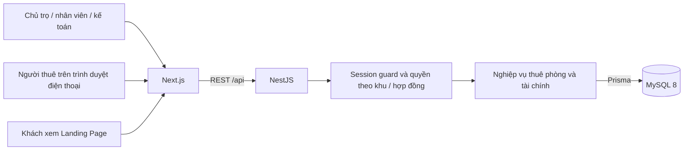
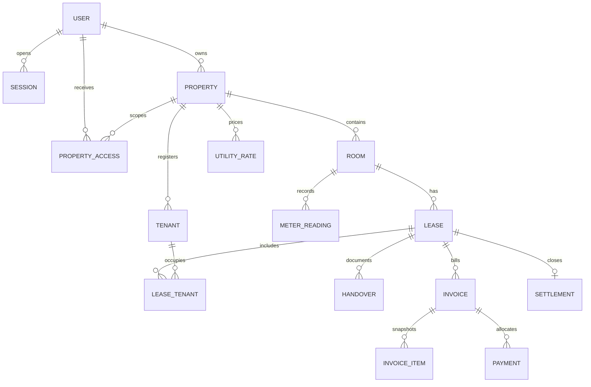

# Kiến trúc

Nghiệp vụ dùng một backend, một MySQL. MySQL áp dụng các khóa duy nhất cho phòng, kỳ chỉ số, hóa đơn còn hiệu lực, khóa yêu cầu thanh toán và quyết toán. Kích hoạt hợp đồng, xác nhận thanh toán và chốt trả phòng dùng giao dịch Serializable.

Điện và nước tính theo chênh lệch chỉ số. Phí dịch vụ cố định theo tháng. Hóa đơn dùng đơn giá hiệu lực đầu kỳ, lưu snapshot chỉ số và đơn giá. Làm tròn từng dòng VND theo half-up và cộng bằng Decimal. Tiền cọc thực nhận trừ khấu trừ và bù nợ, sau đó khóa số liệu quyết toán. Khoản bù nợ ghi thành một giao dịch đã xác nhận có phương thức bù cọc.
