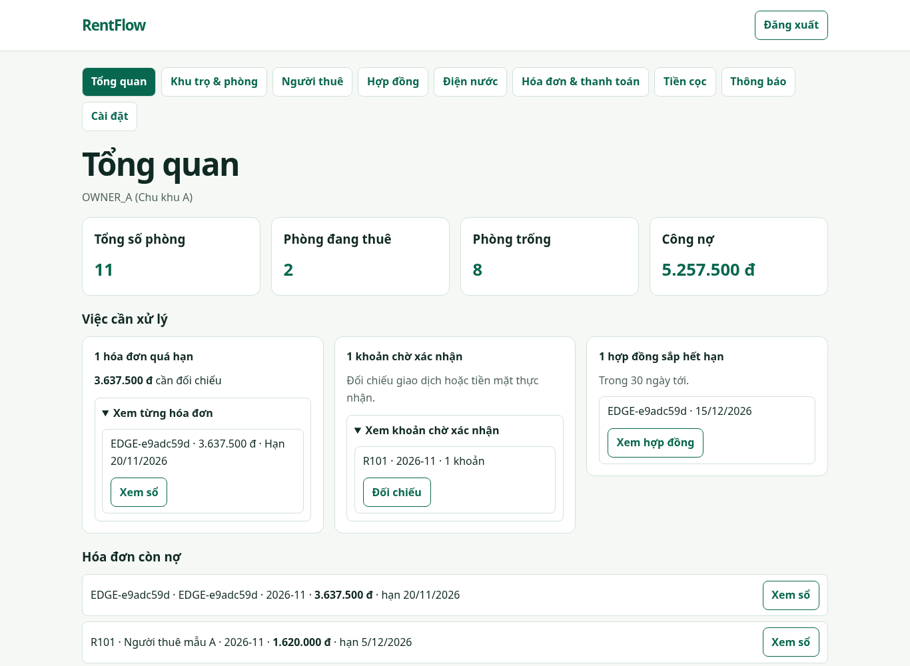
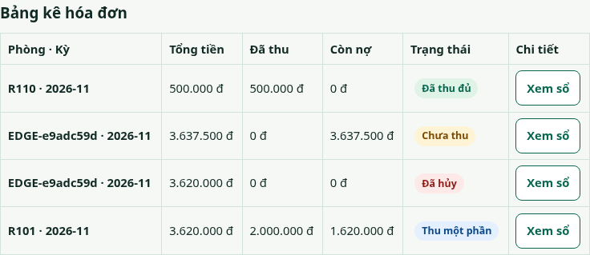
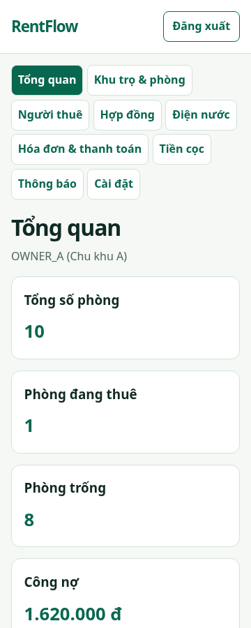

# RentFlow V9.3 — Điều hành và đối chiếu hóa đơn

Bản chạy ngày 25/11/2026 dùng Next.js, NestJS, MySQL 8.0.46 và dữ liệu demo riêng. Số liệu trên ảnh được tính từ các bản ghi demo trong MySQL.

## Ảnh giao diện

### Tổng quan chủ trọ

Danh sách việc cần xử lý mở đúng hóa đơn hoặc sổ hợp đồng. Khoản chờ xác nhận mở phần đối chiếu thanh toán.

### Bảng kê hóa đơn

Bảng kê giữ cả hóa đơn đã hủy và hóa đơn phát hành lại. Công nợ của hóa đơn đã hủy hiển thị 0 đ.

### Điện thoại 360 px

## Kiểm thử

| Hạng mục | Kết quả |
| --- | --- |
| Build backend và web | Đạt cả hai |
| MySQL | Áp dụng đủ 6 migration gốc trên cơ sở dữ liệu demo mới |
| API tích hợp | 16/16 đạt |
| Tài khoản và phân quyền | 8/8 đạt |
| SMTP loopback | 1/1 đạt |
| Kiểm thử tự động trên Chromium | 8/8 đạt, gồm 360, 768 và 1366 px |
| Tìm kiếm tiếng Việt | 1/1 đạt |
| PDF | 1 trang A4, chỉ có hóa đơn được chọn, gồm bảng đơn giá và chỉ số |

Trong bài kiểm thử qua giao diện, hóa đơn 3.620.000 đ được hủy có lý do. Sau khi chỉnh chỉ số điện cuối kỳ từ 220 lên 225, hóa đơn mới có tổng 3.637.500 đ. Bản in chỉ chứa hóa đơn mới. Cùng ca đó tiếp tục kiểm tra báo thanh toán, xác nhận thu và quyết toán cọc. Bài test API kiểm tra thêm việc giữ dòng tiền và đơn giá của hóa đơn cũ, lý do điều chỉnh, nhật ký và giới hạn theo vai trò và khu trọ.

VietQR, báo sửa chữa và ảnh công tơ thuộc các giai đoạn tiếp theo.
