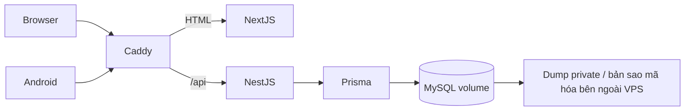

# Kiến trúc production

Một VPS Linux chạy Caddy, Next.js, NestJS và MySQL 8 bằng Compose. Caddy chỉ công bố cổng 80/443. Web và Android dùng chung origin HTTPS, Caddy phân tuyến /api/* đến NestJS, đường dẫn còn lại đến Next.js. API, Web và MySQL giao tiếp nội bộ, MySQL có volume riêng.

Cấu hình trong `deploy/compose.production.yml`. Không có domain hoặc máy chủ production trong workspace này. Trạng thái Internet có bằng chứng riêng.
